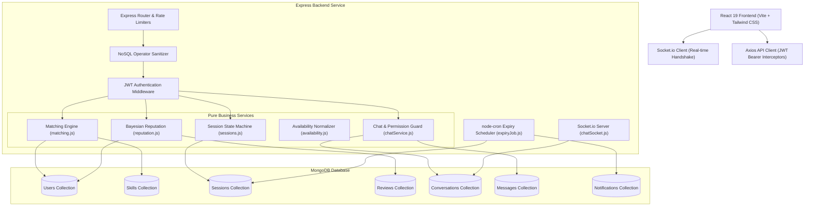

# SkillSwap 🤝
### A Community Skill-Exchange Marketplace (MERN)

[](https://nodejs.org/)
[](https://react.dev/)
[](https://tailwindcss.com/)
[](https://socket.io/)
[](https://www.mongodb.com/)
[]()

---

## 1. Problem Statement
Many people want to learn valuable skills (guitar, Python, conversational Spanish, Photoshop, chess strategy), but cannot afford private tutoring. At the same time, many possess skills that others wish to acquire. Existing platforms are either one-way commercial marketplaces (Udemy, Superprof) or unstructured social forums where matching complementary needs, coordinating across timezones, preventing schedule conflicts, and establishing trust is awkward and inefficient.

## 2. Target Users
- **Students & University Learners:** Want to exchange coding fundamentals for language practice or exam prep without financial barriers.
- **Young Professionals & Career Changers:** Bartering frontend engineering for product design, DevOps, or interview algorithms.
- **Hobbyists & Creatives:** Trading musical instruments, digital illustration, video editing, and languages hour for hour.

## 3. Solution
**SkillSwap** is a full-featured, peer-to-peer knowledge marketplace that treats learning as a balanced, hour-for-hour exchange. It features:
1. **Automated Mutual-Match Engine:** Scores cross-skill synergy, detects level fit, and normalizes multi-timezone weekly schedules into overlapping UTC intervals.
2. **Conflict-Free Session Negotiation State Machine:** Guarantees double-booking prevention through atomic conditional updates and automated expiration.
3. **Real-Time WebSocket Chat:** Persisted messaging, typing indicators, read receipts, and live session alerts.
4. **Verified Bayesian Reputation System:** Enforces mutual confirmation before reviews and applies Bayesian priors to prevent rating manipulation.

---

## 4. Key Features

- **Authentication & User Profiles:** JWT authentication (bearer token / cookie), bcrypt hashing (cost 10+), and structured weekly availability editor with automatic interval merging.
- **Dynamic Skill Catalog with Autocomplete:** Autocomplete search over 44+ seeded skills with automatic slug and alias resolution (`resolveSkill`).
- **Ranked Matching Algorithm:** Ranks prospective partners based on mutual match bonuses (+50), one-way match (+20), level fit (+5), overlapping availability (+2/hr, cap 20), and reputation.
- **Conflict-Free Session Lifecycle:** Complete finite-state machine (`proposed` -> `accepted` | `countered` | `declined` | `cancelled` | `expired` -> `completed`) with atomic collision protection.
- **Auto-Expiry Cron Scheduler:** Automated background job checking overdue proposals and notifying participants.
- **Bayesian Reputation & Verified Reviews:** Mathematically guaranteed anti-inflation rating system where veterans with consistent high ratings outrank one-off reviews.
- **Real-Time WebSockets:** JWT-authenticated Socket.io handshake, private room routing (`user:<userId>`), and conversation threading.

---

## 5. Architecture & System Overview

### System Architecture Diagram



---

### Session Negotiation State Machine

```mermaid
stateDiagram-v2
    [*] --> proposed: Proposer creates proposal (in future, conflict-checked)
    
    proposed --> accepted: Partner accepts (Atomic conflict check)
    proposed --> declined: Partner declines
    proposed --> countered: Partner suggests new time slot
    proposed --> cancelled: Proposer or partner cancels
    proposed --> expired: 48h timeout or start time passes (node-cron)

    countered --> [*]: Original marked countered; new session created in 'proposed'
    declined --> [*]
    expired --> [*]

    accepted --> cancelled: Cancelled by either party (before start time)
    accepted --> completed: Confirmed by BOTH participants (after end time)
    
    completed --> [*]: Enables Verified Review submission
```



---

### Algorithmic & Mathematical Specifications

#### 1. Matching Algorithm (`services/matching.js`)
For any candidate $B$ evaluated against target user $A$:
$$\text{Score} = \text{BaseMatch} + \text{LevelFit} + \text{AvailabilityOverlap} + \text{ReputationBoost}$$

1. **Base Match:**
   - **Mutual Match:** $A$ offers what $B$ wants AND $B$ offers what $A$ wants $\rightarrow \mathbf{+50\text{ points}}$
   - **One-Way Match:** Either direction matches $\rightarrow \mathbf{+20\text{ points}}$
   - **Zero Overlap:** Excluded from results ($\text{Score} = \text{null}$).
2. **Level Fit:** $\mathbf{+5\text{ points}}$ if any taught skill is at `intermediate` or `expert` level.
3. **Availability Overlap:**
   - Both users' weekly availability slots $[0, 1440]$ are projected into a continuous 1-week UTC space $[0, 10080\text{ min}]$ using their local timezone offsets.
   - Exact 1D interval intersections compute total overlapping minutes $M_{\text{overlap}}$.
   - Points: $\min(20, \frac{M_{\text{overlap}}}{60} \times 2)$ ($+2$ points per overlapping hour/week, capped at 20).
4. **Reputation Boost:** $(B_{\text{bayesian}} - 3.0) \times 3.0$.

#### 2. Bayesian Average Reputation Formula (`services/reputation.js`)
To prevent a newly registered user with a single 5-star review from outranking a veteran teacher with dozens of consistent 4.8-star reviews, SkillSwap implements a weighted Bayesian mean:

$$B = \frac{C \cdot m + \sum_{i=1}^n r_i}{C + n}$$

Where:
- $m = 3.5$ (prior mean rating)
- $C = 5$ (prior confidence weight, equivalent to 5 baseline observations)
- $n = $ total verified reviews received
- $\sum r_i = $ sum of ratings

**Mathematical Proof (Verified by Jest test suite):**
- **User with 1 review of 5.0 ★:**
  $$B = \frac{5 \cdot 3.5 + 5}{5 + 1} = \frac{17.5 + 5}{6} = \mathbf{3.75}$$
- **User with 20 reviews averaging 4.8 ★:**
  $$B = \frac{5 \cdot 3.5 + (20 \cdot 4.8)}{5 + 20} = \frac{17.5 + 96}{25} = \frac{113.5}{25} = \mathbf{4.54}$$
- Result: **$3.75 < 4.54$**, correctly protecting marketplace credibility.

---

## 6. Tech Stack

| Layer | Technologies |
| :--- | :--- |
| **Frontend** | React 19 (Vite), React Router v7, Tailwind CSS v4, Axios, Socket.io-client, Lucide Icons |
| **Backend** | Node.js (v24), Express, Mongoose, Socket.io, node-cron, bcryptjs, jsonwebtoken, Zod |
| **Database** | MongoDB (Atlas in production, embedded MongoMemoryServer for local dev/testing) |
| **Testing** | Jest, Supertest, mongodb-memory-server (64 automated tests) |
| **Security** | Helmet, CORS origin restriction, Mongo operator sanitization, express-rate-limit, Zod validators |

---

## 7. Step-by-Step Local Setup

### Prerequisites
- Node.js (v18.0.0 or higher, recommended v20+ or v24)
- npm (v9.0.0 or higher)

### 1. Clone & Install Dependencies
```bash
git clone https://github.com/skillswap/skillswap.git
cd skillswap

# Install root dependencies
npm install

# Install server dependencies
cd server && npm install

# Install client dependencies
cd ../client && npm install
cd ..
```

### 2. Configure Environment Variables
Copy the provided `.env.example` files:
```bash
# In server directory
cp server/.env.example server/.env

# In client directory
cp client/.env.example client/.env
```

> **Note for Local Development:**
> If you do not have a standalone MongoDB instance running, set `MONGODB_URI=memory` in `server/.env`. SkillSwap will automatically spin up an embedded `MongoMemoryServer` with zero installation required!

### 3. Seed Realistic Demo Data
Run the idempotent seed script to populate ~44 skills, 20+ realistic profiles, mutual match pairs, and completed sessions with reviews:
```bash
npm run seed
```

### 4. Start the Application
You can run both client and server concurrently:
```bash
npm run dev:all
```
Or run each service in separate terminals:
```bash
# Terminal 1: Backend API (port 5000)
npm run dev:server

# Terminal 2: Frontend Client (port 5173)
npm run dev:client
```

Open your browser at `http://localhost:5173`.

---

## 8. Environment Variables Reference

### Server (`server/.env`)
| Variable | Description | Default / Example |
| :--- | :--- | :--- |
| `NODE_ENV` | Application environment (`development`, `test`, `production`) | `development` |
| `PORT` | HTTP server port | `5000` |
| `MONGODB_URI` | MongoDB connection string (or `memory` for embedded) | `mongodb://localhost:27017/skillswap` |
| `JWT_SECRET` | Cryptographic secret key for signing JWTs (min 16 chars) | `skillswap_super_secret_jwt_key_2026_dev_min16` |
| `JWT_EXPIRES_IN` | Token expiration duration | `7d` |
| `CLIENT_URL` | Allowed frontend URL for CORS | `http://localhost:5173` |
| `RATE_LIMIT_WINDOW_MS` | Rate limiting window in milliseconds | `900000` (15 min) |
| `RATE_LIMIT_MAX` | Maximum API requests allowed per window per IP | `500` |

### Client (`client/.env`)
| Variable | Description | Default / Example |
| :--- | :--- | :--- |
| `VITE_API_URL` | Base URL for REST API requests | `/api` |
| `VITE_SOCKET_URL` | Base URL for Socket.io WebSocket connection | `/` |

---

## 9. Testing Guide

SkillSwap includes **64 automated tests** covering core application logic:
- `matching.test.js`: Pure interval intersection, UTC timezone conversions, mutual-match scoring, ranking.
- `sessions.test.js`: Complete state machine (all legal and illegal transitions), atomic conflict checks, completion confirmation.
- `reputation_and_reviews.test.js`: Mandatory Bayesian reputation calculations, review authorization and duplicate checks.
- `expiry_and_notifications.test.js`: Automated cron expiry execution and notification persistence.
- `chat.test.js`: Conversation permission guards, REST message retrieval, and real-time WebSocket handshake and message events.
- `auth.test.js`: Password hashing, token signing, authentication middleware, unauthorized access rejection.
- `skills_and_users.test.js`: Skill resolution, alias lookup, availability range normalization and merging.
- `health.test.js`: Service uptime and 404 handler responses.

To run the complete test suite:
```bash
npm test
```
To run with coverage reporting:
```bash
npm run test:coverage --prefix server
```

---

## 10. Demo Account Credentials

Use the pre-configured demo account to evaluate the platform in under 4 minutes:
- **Email:** `demo@skillswap.dev`
- **Password:** `Password123!`
- **Profile:** Alex Rivera (Demo)
- **Features ready to explore upon login:**
  - 🌟 **Mutual Matches:** Instant mutual matches with Maria Rodriguez (Spanish <-> Python) and Viktor Kasparov (Chess <-> Guitar).
  - 📩 **Incoming Proposal:** Pending session proposal from Maria Rodriguez ready to Accept, Decline, or Counter-propose.
  - 📅 **Upcoming Booking:** Accepted session with Viktor ready to inspect or message.
  - 💬 **Live Chat Thread:** Active conversation history with Maria Rodriguez with unread badge.
  - 🔔 **Notifications Dropdown:** Unread session proposals and review alerts.

---

## 11. Deployment Guide

### A. Backend on Render / Railway
1. Create a **Web Service** pointing to the repository root.
2. Set Root Directory to `server`.
3. Build Command: `npm install`
4. Start Command: `npm start`
5. Configure Environment Variables in the provider dashboard (`NODE_ENV=production`, `MONGODB_URI`, `JWT_SECRET`, `CLIENT_URL`).
6. WebSockets are natively supported over standard port 443 / 80.

### B. Frontend on Vercel / Netlify
1. Connect repository on Vercel.
2. Root Directory: `client`.
3. Build Command: `npm run build`
4. Output Directory: `dist`
5. Set `VITE_API_URL` and `VITE_SOCKET_URL` to your live backend domain.
6. `client/vercel.json` contains SPA routing rules to prevent 404s on browser reload.

### C. MongoDB Atlas
1. Create a free M0 cluster on MongoDB Atlas.
2. Create database user and whitelist `0.0.0.0/0` (or host IP).
3. Set `MONGODB_URI=mongodb+srv://<user>:<password>@cluster.mongodb.net/skillswap?retryWrites=true&w=majority`.

---

## 12. Design Decisions & Trade-Offs

1. **Embedded MongoMemoryServer Fallback in Development:**
   - *Rationale:* Evaluators and developers frequently test projects on machines without a native MongoDB daemon running. Rather than failing at startup, SkillSwap gracefully boots an in-memory database in development if `MONGODB_URI=memory` or if local connection fails, ensuring zero-configuration evaluation.
2. **Atomic Collision Checks in Sessions:**
   - *Rationale:* Double-booking is a critical failure in marketplaces. Rather than relying on simple application-level `if` statements prone to race conditions, SkillSwap uses atomic conditional database queries (`findOneAndUpdate` checking `status === 'proposed'` and re-verifying overlapping `accepted` intervals).
3. **Canonical Participant Keys for Conversations:**
   - *Rationale:* User A messaging User B must map to the exact same conversation as User B messaging User A. A sorted compound string key (`minId_maxId`) guarantees uniqueness at the database layer with $O(1)$ lookup time.
4. **Timezone Normalization via 1D Week-Interval Intersection:**
   - *Rationale:* Storing availability in minutes from midnight ($0-1440$) in the user's timezone makes UI editing intuitive. The backend dynamically converts these into continuous UTC minute intervals ($0-10080$), seamlessly handling week-boundary wrapping (e.g. Sunday UTC offsets).

---

## 13. Known Limitations & Future Work

- **Video Call Integration:** Currently sessions facilitate coordination, scheduling, and real-time messaging. Future work includes integrating WebRTC or Jitsi Meet for embedded 1-on-1 video rooms.
- **Calendar Export (.ics):** Generating downloadable `.ics` files or Google Calendar sync for accepted sessions.
- **Time Banking System:** Implementing a balance ledger where 1 hour taught gives 1 credit, allowing non-simultaneous credit transfers across the community.

---

## 14. License
MIT License. Built for community peer-to-peer education.
